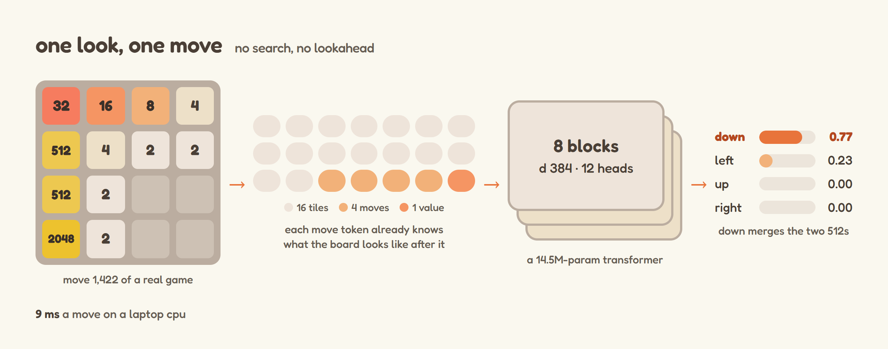
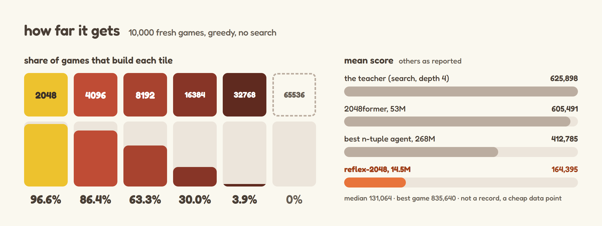
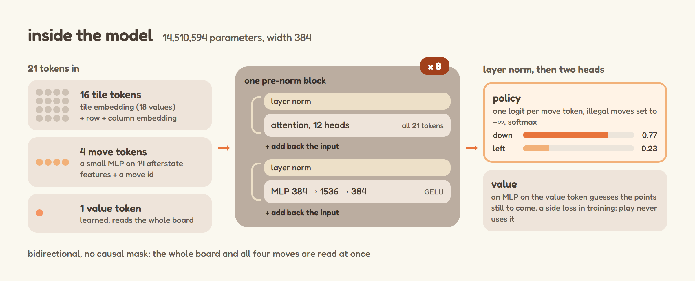
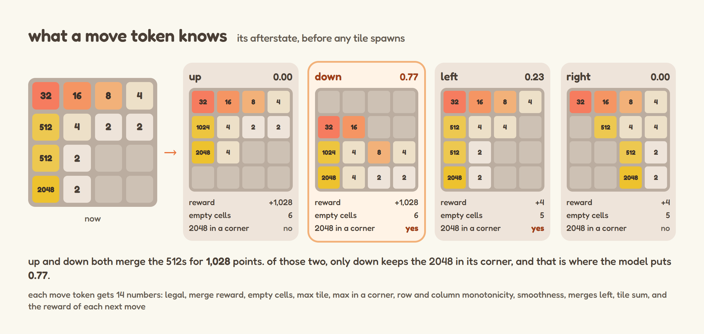
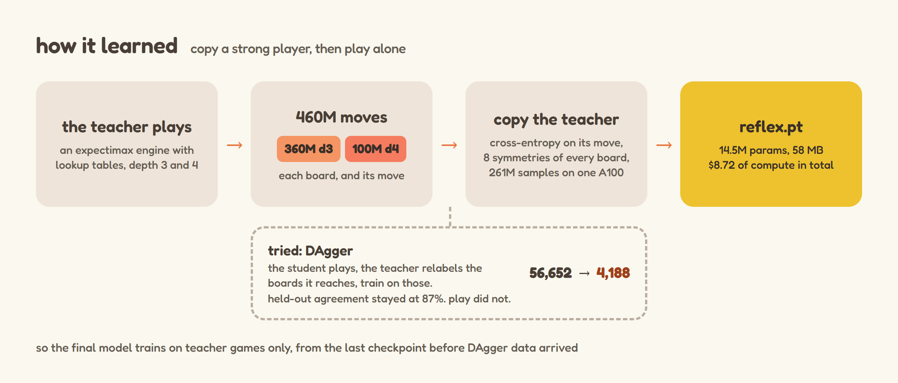

# reflex-2048

a 14.5M-parameter transformer that plays 2048 with one forward pass per move and no search. it's distilled from an expectimax + lookup-table teacher ([macroxue/2048-ai](https://github.com/macroxue/2048-ai)) on one rented A100, for $8.72 total.

it averages 164k. that's about a quarter of its teacher, 40% of the best n-tuple agent, and well short of the best search-free transformer, so this is a cheap data point, not a record. the two things that went wrong taught me more than the score did.



## results



10,000 fresh games, greedy policy, end-of-schedule checkpoint (not picked by eval score):

| mean | median | max | 2048 | 4096 | 8192 | 16384 | 32768 | 65536 |
|---|---|---|---|---|---|---|---|---|
| 164,395 | 131,064 | 835,640 | 96.6% | 86.4% | 63.3% | 30.0% | 3.9% | 0% |

a second eval on 2,048 games from other seeds gave 166,767 mean, within 1.5%. i didn't log per-game scores, so there are no standard errors.

the other agents, as reported:

| agent | params | search | mean | 32768 |
|---|---|---|---|---|
| macroxue expectimax, large tables (the teacher) | tables | depth 4 | 625,898 | 70.7% |
| 2048former v0.1 (self-reported) | 53.2M | none | 605,491 | 66.1% |
| Guei et al. 2021, n-tuple (best published 1-ply) | 268.4M | none | 412,785 | 30.2% |
| reflex-2048 | 14.5M | none | 164,395 | 3.9% |
| reflex-2048 + 1-ply over its value head (128 games) | 14.5M | 1-ply | 4,189 | 0% |

2048former is 3.7× bigger, learned from a depth-6 teacher, and trained for about 30× the compute (72 vs 2.4 GPU-hours), so the gap to it mixes all three.

a move takes 9.1 ms median on a laptop CPU (Intel, 8 threads, batch 1, features included). batched on the A100 it plays 65k moves/s.

### what went wrong

DAgger collapsed play. i relabelled the student's own states with the teacher and mixed them into 30% of each batch, and greedy play went from 56,652 to 4,188 mean. held-out agreement with the teacher sat at ~87% the whole time, so every training metric looked healthy. the labels match the teacher's self-play moves on 99.95% of boards and the game code didn't change. i still don't know the cause. the released model restarts from the last checkpoint before any DAgger data arrived and trains on teacher data only.

1-ply search over the value head scores 4,189. the head tracks the return across a game (0.88 log-space correlation on held-out teacher boards), but it can't rank the four afterstates of one move.

the probabilities are only calibrated on the teacher's boards. there, ECE is 0.006 (93.6% agreement at 0.93 mean confidence). on boards the student reaches by itself (fresh seeds, never trained on) it agrees with the teacher 61% of the time at 0.88 confidence, an ECE of 0.27.

the full write-up is [paper/main.pdf](paper/main.pdf).

## play it on your laptop

```bash
pip install torch numpy
```

download `reflex.pt` from the [latest release](https://github.com/a3ro-dev/reflex-2048/releases) or from [Hugging Face](https://huggingface.co/a3ro-dev/reflex-2048) (the model card has a `snapshot_download` snippet), then:

```bash
python -m reflex.play --ckpt reflex.pt --seed 0 --every 500
```

from python:

```python
from reflex.model import load
m = load("reflex.pt")
m.decide([[0, 1, 0, 0], [0, 0, 0, 0], [0, 0, 1, 0], [0, 0, 0, 0]])   # tile exponents, 0 = empty
# {'UP': ..., 'DOWN': ..., 'LEFT': ..., 'RIGHT': ...}
```

## how it works







the input is 21 tokens. 16 are tiles (tile-exponent + row + column embeddings). 4 are moves, each built from that move's afterstate: legality, reward, empties, max tile and whether it's in a corner, monotonicity, smoothness, merges, and the rewards of the follow-up moves. the last one is a value token.

those go through 8 pre-norm bidirectional transformer blocks (d=384, 12 heads). each move token gives one logit, and illegal moves are masked.

the loss is cross-entropy to the teacher's move plus 0.25× a Huber loss on log return-to-go, with a random D4 symmetry per sample.

the data is 360M depth-3 teacher decisions (21.9k games, mean 455k) and 100M depth-4 decisions. every teacher transition replays exactly in the batched GPU env (`reflex/env.py`). training saw 261M samples in bf16, and the A100 tops out around 38k samples/s, so it's compute-bound.

## repo map

- `reflex/env.py`: batched GPU 2048.
- `reflex/model.py`: the transformer.
- `reflex/train.py`: distillation.
- `reflex/evaluate.py`: parallel games. `--sym` averages over symmetries, `--ply1` gives the 1-ply row.
- `reflex/dagger.py`: the DAgger loop.
- `reflex/play.py`: watch a game on CPU.
- `teacher/patch_teacher.py`: patches macroxue/2048-ai to dump every decision (`-o`) and to label arbitrary boards (`-B`). that code is GPL-3.0, so it ships here as a patch script instead of a copy.
- `scripts/`: launcher, resume, final eval, calibration report, benchmarks, budget watchdog.
- `paper/`: NeurIPS-format write-up.

the $8.72 includes one pod migration, after the original host's GPU got taken.

## thanks

every GPU-hour here was paid for with RunPod credits from [Pranav Ramakrishnan](https://www.linkedin.com/in/pranavram98/). none of this runs without them. thank you, Pranav.
